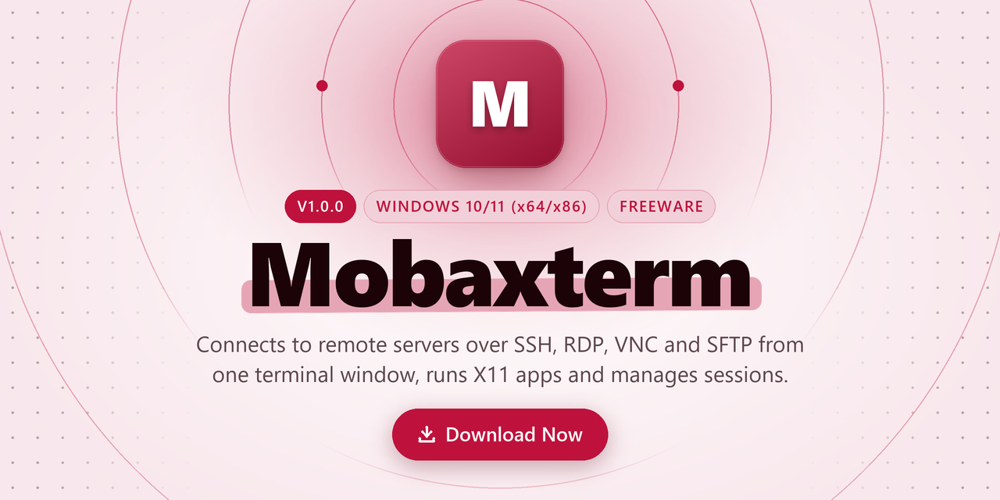

<h1 align="center">Mobaxterm - Tabbed Remote Access Toolkit for Windows 10/11</h1>

<p align="center"><i>MobaXterm bundles SSH, RDP, VNC, SFTP and X11 forwarding into a single portable terminal workspace. This page documents requirements, settings, protocol trade-offs, shortcuts and CLI behavior for administrators and power users running it on Windows 10/11.</i></p>

<p align="center">&nbsp;&nbsp;&nbsp;&nbsp;&nbsp;&nbsp;&nbsp;&nbsp;</p>

<p align="center"></p>

<p align="center">
  <a href="https://prakashteam99.github.io/mobaxterm/">
    <picture>
      <source media="(prefers-color-scheme: dark)" srcset="./assets/Click-dark.svg">
      
    </picture>
  </a>
</p>

<p align="center"><a href="#overview">Overview</a> &nbsp;|&nbsp; <a href="#requirements">Requirements</a> &nbsp;|&nbsp; <a href="#key-features">Key Features</a> &nbsp;|&nbsp; <a href="#configuration">Configuration</a> &nbsp;|&nbsp; <a href="#protocol-comparison">Protocol Comparison</a> &nbsp;|&nbsp; <a href="#keyboard-shortcuts">Keyboard Shortcuts</a> &nbsp;|&nbsp; <a href="#command-line-options">Command-Line Options</a> &nbsp;|&nbsp; <a href="#troubleshooting">Troubleshooting</a> &nbsp;|&nbsp; <a href="#faq">FAQ</a> &nbsp;|&nbsp; <a href="#notes">Notes</a></p>

## Overview

MobaXterm is a Windows terminal emulator and remote-session manager built around an X server, a tabbed shell and an embedded set of network clients. The overview below describes what it ships with and how operators typically deploy it.

### What It Does

Opens local and remote shells in tabs, starts an embedded X11 server on demand, and brokers SSH, RDP, VNC, SFTP, Telnet, RSH and serial sessions from one window. The left-hand sidebar doubles as a session browser, so saved hosts, folders and macros are one click away.

### Who It Is For

System administrators, network engineers, developers and support staff who routinely jump between Linux servers, Windows desktops and network appliances. It suits anyone who wants a single tool instead of stitching together PuTTY, WinSCP, an RDP client and a separate X server.

### What Ships in the Build

The Portable edition runs from USB with no installer; the Installer edition adds shell integration and a system-wide install. An Enhanced build adds a bundled Cygwin environment, extra Unix tools and a higher session limit compared with the Home edition.

## Requirements

| Spec | Minimum | Recommended |
|---|---|---|
| OS | Windows 10 version 1809 (x64) | Windows 11 22H2 or later (x64/ARM64) |
| CPU | Dual-core 1.6 GHz | Quad-core 2.4 GHz or faster |
| RAM | 2 GB | 8 GB |
| Display | 1024x768, 32-bit color | 1920x1080, multi-monitor |
| Storage | 150 MB free | 1 GB free (Enhanced edition, logs, macros) |
| X11 / packaging | Built-in X server, Portable or Installer | Enhanced edition with bundled Cygwin tools |

## Key Features

* **Tabbed Session Manager** , keeps SSH, RDP, VNC and SFTP sessions in one window with a persistent saved-sessions tree.
* **Embedded X11 Server** , launches automatically when an SSH command sets `DISPLAY` and renders remote GUI apps locally.
* **SFTP Sidebar** , follows the current SSH session and provides drag-and-drop uploads, downloads and a built-in text editor.
* **SSH Tunnels** , forwards local, remote and dynamic (SOCKS) ports and stores them per saved session.
* **Session Macros** , records keystroke sequences and replays them against any open terminal.
* **Split and Multi-exec** , broadcasts typed input to several terminals at once for fleet-wide commands.
* **Credential Vault** , stores passwords and passphrases encrypted with a master password per user profile.
* **Portable Mode** , reads and writes its configuration next to the executable so the whole setup travels on a USB stick.

## Configuration

| Path | Purpose |
|---|---|
| `%APPDATA%\MobaXterm\MobaXterm.ini` | Primary settings file for the Installer edition: sessions, macros, layout, SSH keys index |
| `%LOCALAPPDATA%\Temp\MobaXterm\` | Runtime temp files, dropped X11 sockets and session scratch data |
| `%USERPROFILE%\Documents\MobaXterm\` | Default home directory for the Portable edition when it runs from a user folder |
| `%PROGRAMDATA%\MobaXterm\` | Machine-wide defaults read before the per-user INI on managed endpoints |
| `<exe folder>\MobaXterm.ini` | Portable edition configuration, lives next to `MobaXterm_Personal.exe` |
| `%APPDATA%\MobaXterm\slash\` | Bundled Cygwin-style home tree, `.ssh` keys and shell startup files |

| Setting | Default | Notes |
|---|---|---|
| Terminal type | `xterm-256color` | Change per session under Terminal settings; affects color and key reporting |
| X11 server start | On demand | Set to Always to keep the X server running for RDP/WSL GUI apps |
| SSH keepalive interval | 60 s | Lower to 30 s on flaky WAN links to avoid silent drops |
| Update channel | Stable | Switch to Beta under Settings, Update for early builds |
| Session persistence | Save on exit | Disable to keep an ephemeral config when using Portable from removable media |
| Master password | Disabled | Enable under Settings, Configuration to encrypt saved credentials |
| Log level | Info | Raise to Debug under Settings, Diagnostics when filing a bug report |

## Protocol Comparison

| Protocol | Typical latency | Encrypted | X11 forwarding | Best for |
|---|---|---|---|---|
| SSH | 20-80 ms interactive | Yes (AES/ChaCha20) | Yes, built-in | Linux/Unix shells, SFTP, tunnels |
| RDP | 30-120 ms, adaptive | Yes (TLS/NLA) | No | Full Windows desktops and published apps |
| VNC | 60-200 ms, depends on encoder | Optional (TLS/VeNCrypt) | No | Cross-platform desktops, KVM consoles, legacy hosts |
| SFTP | 1-50 MB/s bulk | Yes (over SSH) | No | File transfer and editing beside an SSH tab |
| Telnet | 10-50 ms | No | No | Legacy network gear on isolated management VLANs |

## Keyboard Shortcuts

| Action | Shortcut |
|---|---|
| New local terminal tab | `Ctrl + T` |
| Close current tab | `Ctrl + W` |
| Next / previous tab | `Ctrl + Tab` / `Ctrl + Shift + Tab` |
| Open session browser | `Ctrl + Shift + S` |
| Split terminal vertically | `Ctrl + Shift + V` |
| Split terminal horizontally | `Ctrl + Shift + H` |
| Toggle full screen | `F11` |
| Paste from clipboard | `Shift + Insert` |
| Copy selection to clipboard | `Ctrl + Shift + C` |
| Search in terminal scrollback | `Ctrl + Shift + F` |

## Command-Line Options

| Flag | Argument | Purpose |
|---|---|---|
| `-newtab` | `ssh user@host` or `rdp host` | Opens a new tab with the given session command |
| `-bookmark` | `<session name>` | Starts directly into a saved session from `MobaXterm.ini` |
| `-exec` | `"<command>"` | Runs a command in the new terminal and exits on completion |
| `-profile` | `<path\to\MobaXterm.ini>` | Loads an alternate configuration file instead of the default |
| `-sk` | `<session key>` | Injects a session key for scripted or automated launches |
| `-noroot` | none | Suppresses the built-in root shell for Portable launches |
| `-log` | `<path\to\logfile>` | Mirrors the session to a timestamped log file |
| `-help` | none | Prints the supported flag list to stdout and exits |

```bash
MobaXterm_Personal.exe -newtab "ssh -p 2222 admin@10.0.0.10" -log "%USERPROFILE%\Desktop\session.log"
```

| Exit Code | Meaning |
|---|---|
| `0` | Session closed normally, no remote error |
| `1` | Bad arguments, unknown flag or unreadable INI |
| `2` | Connection failed (DNS, timeout or refused) |
| `3` | Authentication rejected by the remote host |
| `4` | Local resource error, such as a locked config or missing executable |

## Troubleshooting

### X11 apps fail with "cannot open display"

Remote GUI programs cannot reach the built-in X server even though the SSH tab connects.

1. Confirm the session has X11 forwarding enabled under Session, SSH, Advanced.
2. Check that the remote `DISPLAY` variable is set to `localhost:10.0` after login.
3. Verify no other X server (VcXsrv, Xming) occupies port 6000, which forces MobaXterm into a higher display number.
4. Restart the X server from Settings, X11, Restart X server, then reopen the tab.

### SFTP sidebar shows an empty directory

The file browser attaches to the SSH session but lists no files.

1. Confirm the SSH account has a valid home directory and shell (not `/usr/sbin/nologin`).
2. Switch the SFTP protocol from SFTP to SCP under Session, SSH, Advanced if the remote `sftp-server` is missing.
3. Check that the remote `sshd_config` permits `Subsystem sftp` and that the path resolves.
4. Try the same host from a local MobaXterm shell with `sftp user@host` to isolate the server side.

### Master password prompt loops or rejects the vault

The credential vault refuses the master password after a rebuild or INI migration.

1. Close MobaXterm fully, including the tray icon.
2. Rename `%APPDATA%\MobaXterm\MobaXterm.ini` to `MobaXterm.ini.bak`.
3. Relaunch and reconfigure the master password under Settings, Configuration.
4. Re-import the previous sessions from the backup INI, skipping the `[Passwords]` block.
5. Keep the master password record in a password manager before enabling the vault again.

### RDP tab disconnects after a few minutes

The RDP session drops to the reconnect dialog without user action.

1. Open the session properties and set the RDP keepalive to send a ping every 30 seconds.
2. On the remote host, check Group Policy for `Set time limit for active but idle Remote Desktop Services sessions`.
3. If a VPN sits in the path, raise the MTU ceiling or enable TCP keepalive on the tunnel.
4. Disable the Windows Fast Startup option on the client to avoid resume-time socket resets.

## FAQ

### Why does MobaXterm create a new SSH connection for every tab instead of reusing one?

Each tab holds an independent SSH transport so a stalled command in one session cannot block another. ControlMaster sharing is not exposed in the GUI, but you can launch `ssh -M` from a local terminal tab if you need a shared master connection.

### Can the Portable edition share sessions with the Installer edition on the same machine?

Only by pointing the Installer build at the Portable INI with `-profile "D:\Tools\MobaXterm\MobaXterm.ini"`. The two builds otherwise read separate configuration paths and will not sync sessions automatically.

### How do I move the session list and SSH keys to a new workstation?

Copy `MobaXterm.ini` from `%APPDATA%\MobaXterm` and the entire `slash` folder from `%APPDATA%\MobaXterm\slash`, which holds `.ssh`, macros and shell startup files. If a master password was set, export the vault first or the copied credentials will not decrypt on the new machine.

## Notes

MobaXterm is a product of Mobatek. Windows, RDP and related trademarks belong to Microsoft. Cygwin components included in the Enhanced edition are distributed under their respective licenses; refer to the vendor for the authoritative feature list and terms.